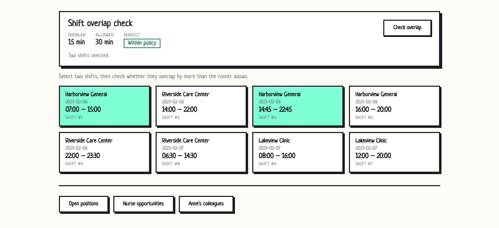
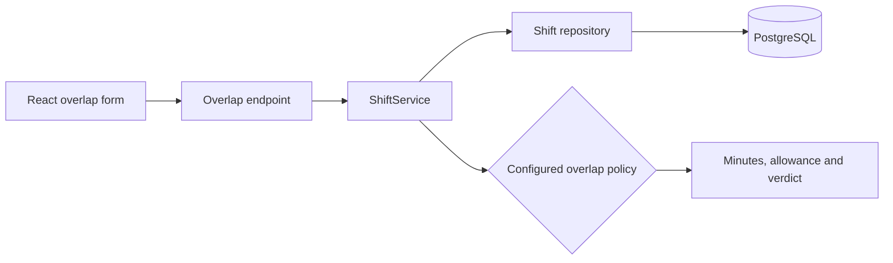

# bravocare: shift overlap and staffing

An Express + Prisma API on PostgreSQL with a React client, written for a staffing exercise. The main feature checks whether two nurse shifts overlap more than allowed. It also answers a few staffing queries: open positions per job, jobs each nurse is still eligible for, and which nurses share a facility.

The overlap rule: shifts at the same facility can overlap by up to 30 minutes (handover), and shifts at different facilities can't overlap at all. Both limits are configurable through environment variables.



## Running with Docker

```sh
cp .env.example .env    # optional
docker compose up --build
```

This starts Postgres, runs the migrations and seed in a one-off `migrate` service, then starts the API on http://localhost:8601 and the client on http://localhost:8600.

## Running locally

You'll need PostgreSQL and Node 22.12+.

```sh
cp .env.example .env    # set DATABASE_URL
npm install
npm run db:migrate
npm run db:seed
npm start               # API on http://localhost:3000
```

In another terminal:

```sh
cd client
cp .env.example .env.local
npm install
npm start               # http://localhost:3001
```

## Endpoints

The staffing endpoints keep the question numbers from the exercise.

- `GET /health`
- `GET /api/v1/question_one_shifts` paged list of shifts (`limit`, `offset`)
- `POST /api/v1/overlap` with `{ "shift1": id, "shift2": id }`, returns the overlap in minutes, the allowed maximum and whether it's exceeded
- `GET /api/v1/q4` open positions per job
- `GET /api/v1/q5` jobs each nurse can still take
- `GET /api/v1/q6?nurse=Anne` nurses who work at the same facilities as the given nurse

Example requests and responses are in [docs/api-examples.md](docs/api-examples.md).

## Implementation notes

- Night shifts (end time before start time) are treated as ending the next day, and Prisma's `TIME` values are read in UTC to avoid timezone shifts.
- The overlap rule lives in `src/domain/overlapPolicy.js`. There are two policies, `handover` (default) and `strict`, and a custom one can be injected into `ShiftService`.
- Question 5 pages through nurses inside the SQL query, before the join. On a large synthetic dataset this made a big difference, see [docs/benchmarks.md](docs/benchmarks.md).
- The second migration adds foreign keys and indexes on the join columns.

Main settings (`.env.example`): `DATABASE_URL`, `PORT`, `CORS_ORIGIN`, `SAME_FACILITY_OVERLAP_ALLOWANCE_MINUTES`, `CROSS_FACILITY_OVERLAP_ALLOWANCE_MINUTES`, `DEFAULT_PAGE_SIZE`, `MAX_PAGE_SIZE`.

## Tests

```sh
npm test              # API tests (node:test + supertest)
npm run test:client   # React tests (Jest + React Testing Library)
npm run lint
```

Neither suite needs a database. The API tests run against in-memory repositories.

## Limitations

- No authentication and no endpoints for creating or editing shifts.
- Overlap is checked between two shifts at a time, not across a whole roster.
- All seed data is made up.

## Policy boundary



The automated API suite injects an in-memory repository. Deployment still needs
PostgreSQL, migrations and seed data; the tests do not validate a running container.

## Author

[**Muhammad Nadeem**](https://github.com/dev-mnadeem)
